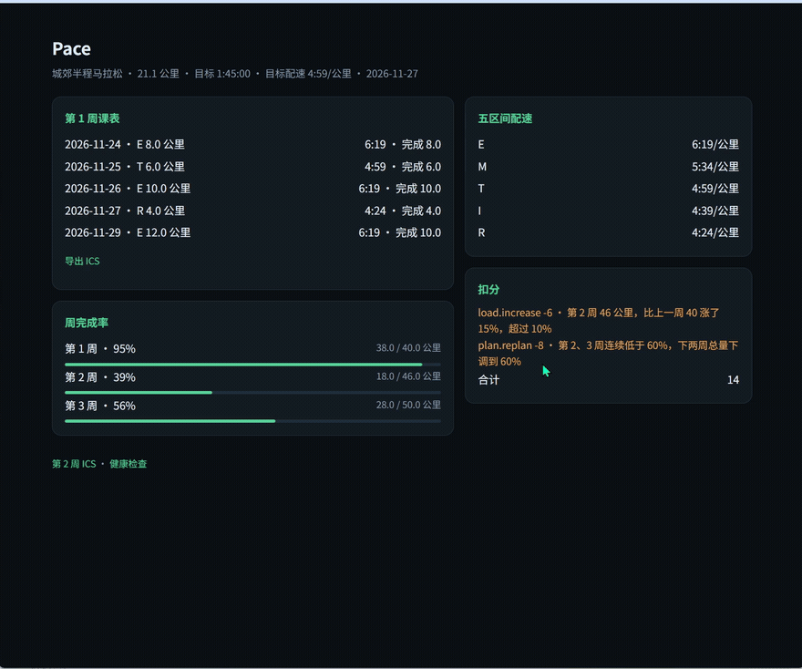
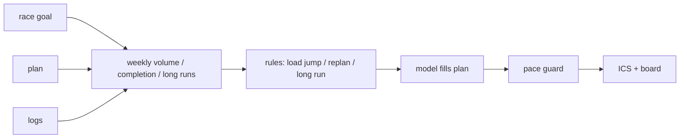

# Pace · race training

[](https://github.com/wushiyi105-jpg/pace/actions)

[](./LICENSE)



A three-week half-marathon block: five pace zones, weekly load, replanning and an ICS export.

## Features

- Five zones from the goal time: E +80s, M +35s, T goal pace, I −20s, R −35s per kilometre.
- Warns when weekly volume grows more than 10% over the previous week.
- After two consecutive weeks below 60% completion, cuts the next two weeks by 10%.
- Exports one week to an ICS file and drops model paces outside the allowed band.

Rules live in `pace/domain/rules/`; the CLI and the web layer only call them. The Chinese README lists every `rule_id` with its penalty.

## Quickstart

```bash
pip install -e ".[dev]"
python -m pace seed
python -m pace zones
python -m pace week --week 2
python -m pace review
python -m pace ics --week 1
python -m pace serve        # http://127.0.0.1:8014
```

Run `python -m pace --help` for the full command list; `docker build -t pace . && docker run -p 8014:8014 pace` works the same way.

## Why not just ask a general LLM

Training plans break in two places: too much volume too soon, and pushing the original plan after two missed weeks. Pace turns both into numbers you can check, instead of “just hang in there”.

## When to use it

- You signed up for a half marathon and need paces per session.
- Two weeks went badly and you need to know whether to cut volume.

## Roadmap

- Import runs from Strava / Garmin.
- Prescribe sessions by heart-rate zone as well as pace.

## FAQ

**How is the goal pace derived?**
From the target time, then the five zones are offset from it.

**What if I do not use a watch?**
Log kilometres and RPE manually with `log`.

**Was the Docker image verified?**
The CI `docker` job runs `docker build .`, starts the container and polls `/health`; Docker is not installed locally, so it was not re-run on the build machine.

## Commands

See the Chinese README (`README.md`) for the command table with flags; every command supports `--help`.

## Dependencies

FastAPI + Uvicorn, Jinja2, pydantic / pydantic-settings, httpx, Typer + Rich, SQLAlchemy + Alembic; dev extras add pytest, pytest-cov, respx, freezegun, ruff, mypy, pip-audit. Version pinning lives in `uv.lock`.

## How it works



## Layout

```
pace/
├── .github/
│   ├── ISSUE_TEMPLATE
│   ├── PULL_REQUEST_TEMPLATE.md
│   └── workflows
├── assets/
│   └── demo.gif
├── data/
│   ├── pace.db
│   └── seed.json
├── migrations/
│   ├── __init__.py
│   ├── env.py
│   ├── script.py.mako
│   └── versions
├── pace/
│   └── … 9 项
├── prompts/
│   └── coach.md
├── templates/
│   └── index.html
├── tests/
│   ├── __init__.py
│   ├── conftest.py
│   ├── test_engine_ics.py
│   ├── test_load_completion.py
│   ├── test_web_cli.py
│   └── test_zones.py
├── CHANGELOG.md
├── CODE_OF_CONDUCT.md
├── CONTRIBUTING.md
├── Dockerfile
├── LICENSE
├── README.en.md
├── README.md
├── SECURITY.md
├── alembic.ini
├── pyproject.toml
```

## Author

Xiaomi · GitHub [@wushiyi105-jpg](https://github.com/wushiyi105-jpg) · 17612850106
