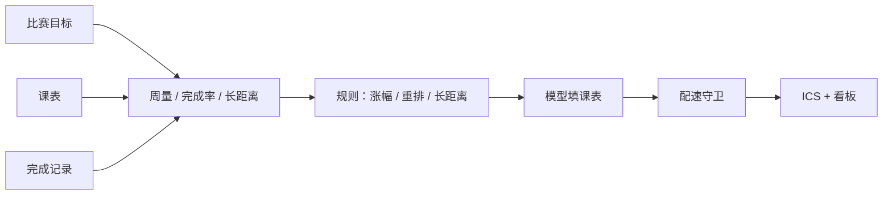

# Pace · 跑步备赛

[](https://github.com/wushiyi105-jpg/pace/actions)

[](./LICENSE)


半马 1:45 的三周课表：五个区间配速、周量增幅、完成率重排，导出 ICS 进日历。


## 功能特性

1. **五区间配速**：E +80 秒、M +35 秒、T 目标、I -20 秒、R -35 秒（每公里）。
2. **周量增幅**：相邻周超过 10% 提醒。
3. **完成率重排**：连续两周低于 60%，下两周降 10%。
4. **赛前长距离**：最长一次要跑到比赛距离的 70%。
5. **ICS 导出**：一周课表直接进日历。

### 规则与扣分

| rule_id | 含义 | 扣分 |
| --- | --- | --- |
| `load.increase` | 相邻周量涨幅 > 10% | 6 |
| `plan.replan` | 连续两周完成率 < 60% | 8 |
| `race.long` | 最长一次不到比赛距离 70% | 5 |
| `guard.pace` | 模型给的配速不在允许带，丢弃 | 6 |

## 快速开始

```bash
pip install -e ".[dev]"
python -m pace seed
python -m pace zones
python -m pace week --week 2
python -m pace review
python -m pace ics --week 1
python -m pace serve        # http://127.0.0.1:8014
```

真实种子：城郊半马 2026-12-20、21.1 公里、目标 1:45:00（目标配速 4:59/公里），三周 15 次课、13 条完成记录。

用这套种子跑 `zones`：E 6:19、M 5:34、T 4:59、I 4:39、R 4:24（每公里）。`review` 出来是
第 1 周 40 公里完成 38（95%）、第 2 周 46 完成 18（39%）、第 3 周 50 完成 28（56%）：
第 2 周比第 1 周涨 15%，判 `load.increase`；第 2、3 周连着低于 60%，判 `plan.replan`，合计扣 14 分。
最长一次 16.5 公里，过了半马 70%（14.8 公里）的线，`race.long` 不触发。

## 为什么不用通用大模型直接问

训练计划最容易崩在两处：一周加太多量，或者连续两周没跑完还硬按原计划顶。Pace 把这两件事变成
可查的数字：相邻周量涨幅超过 10% 直接报；连续两周完成率低于 60% 就建议降量，而不是让你「再坚持一下」。
模型只在区间里填课表，给的配速出了允许带就丢。

## 适用场景

- 报了半马，需要一个三周课表并知道每节课该跑多快。
- 前两周没跑完，想知道该降量还是继续顶。
- 课表想直接进手机日历。

### 边界

- 不接手表/Strava，完成记录自己录；
- RPE 1–10，只作参考；
- 不做伤病判断，疼就停。

## Roadmap

- 接 Strava / Garmin，完成记录自动进来。
- 按心率区间给课，不只按配速。
- 多赛事并行（半马与全马分开排）。

## FAQ

**配速怎么算出来的？**
从目标时间反推，E +80 秒、M +35 秒、T 目标、I −20 秒、R −35 秒（每公里）。

**不接手表怎么记？**
`log` 手动录公里与 RPE。

**什么时候建议降量？**
连续两周完成率低于 60%，下两周计划降 10%。

**Docker 镜像验证了吗？**
CI 的 `docker` job 每次执行 `docker build .`，启动容器并轮询 `/health`；本机没有 Docker，本地未重复跑。

## 命令参考

| 命令 | 作用 | 常用参数 |
| --- | --- | --- |
| `seed` | 写入目标、三周课表与完成记录。 | --db |
| `zones` | 五区间配速表。 | --db |
| `week` | 某一周的课表（只读）。 | --week, --db |
| `log` | 记一次完成。 | --session, --km, --rpe, --db |
| `review` | 周量、完成率、长距离、扣分。 | --db |
| `suggest` | 模型出下周课表（无 key 时打印区间表）。 | --db |
| `ics` | 把某一周导出成 ICS。 | --week, --db |
| `doctor` | 四项体检。 | --db |
| `serve` | Web 界面。 | --port, --db |

全部命令都支持 `--help`；只读命令不带参数时读默认库 `data/pace.db`，写命令用 `--db` 指到别的库。

## 依赖说明

| 依赖 | 为什么装 | 不装会怎样 |
| --- | --- | --- |
| `fastapi` + `uvicorn[standard]` | Web 入口与 ASGI 服务 | 只有命令行，没有页面 |
| `jinja2` | 服务端渲染模板 | 页面出不来 |
| `pydantic` + `pydantic-settings` | 配置与数据结构校验，`.env` 直接生效 | 配置散在代码里，改端口要改源码 |
| `httpx` | 调模型与 webhook 的 HTTP 客户端 | 模型层与推送都不可用 |
| `typer` + `rich` | 命令行与终端表格 | 只能用 curl 调接口 |
| `sqlalchemy` + `alembic` | 本地库与迁移 | 表结构变更只能删库重来 |
| `pytest` / `pytest-cov` / `respx` / `freezegun`（dev） | 单测、覆盖率、HTTP 打桩、冻结时间 | 规则改动没有回归保护 |
| `ruff` / `mypy` / `pip-audit`（dev） | 风格、类型、依赖漏洞检查 | CI 只看测试，类型错误会漏进主干 |

装了 `uv` 的话，`uv sync --extra dev` 会按 `uv.lock` 装同一套版本。

## 工作原理




domain 里是五区间配速、周量增幅、完成率重排与长距离；app 负责周报与 ICS。

## 目录结构

```
pace/
├── .github/
│   ├── ISSUE_TEMPLATE
│   ├── PULL_REQUEST_TEMPLATE.md
│   └── workflows
├── assets/
│   └── demo.gif
├── data/
│   ├── pace.db
│   └── seed.json
├── migrations/
│   ├── __init__.py
│   ├── env.py
│   ├── script.py.mako
│   └── versions
├── pace/
│   └── … 9 项
├── prompts/
│   └── coach.md
├── templates/
│   └── index.html
├── tests/
│   ├── __init__.py
│   ├── conftest.py
│   ├── test_engine_ics.py
│   ├── test_load_completion.py
│   ├── test_web_cli.py
│   └── test_zones.py
├── CHANGELOG.md
├── CODE_OF_CONDUCT.md
├── CONTRIBUTING.md
├── Dockerfile
├── LICENSE
├── README.en.md
├── README.md
├── SECURITY.md
├── alembic.ini
├── pyproject.toml
```

## 质量与供应链

- CI 的 Coverage 步骤带 `--fail-under=70`，覆盖率低于 70% 直接失败。
- `tests/test_app_fake.py` 用真实 `InMemoryStore` 跑主用例，并显式标注 `StorePort` 交给 mypy 做结构校验；测试不创建 SQLite 文件。
- Audit 步骤从 `uv.lock` 导出运行时依赖，再用 `pip-audit -r` 审计；开发工具链不进发布物，运行时依赖有漏洞就让 job 失败，不用 `|| true` 吞错。

## 作者

小米 · GitHub [@wushiyi105-jpg](https://github.com/wushiyi105-jpg) · 17612850106
