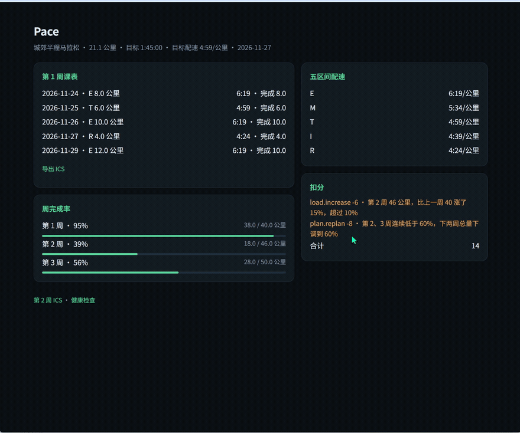

# Pace · 跑步备赛

[](https://github.com/wushiyi105-jpg/pace/actions)

[](./LICENSE)



半马 1:45 的四周课表：五个区间配速、周量增幅、完成率重排，导出 ICS 进日历。

## 为什么不是一张训练计划表

训练计划最容易崩在两处：一周加太多量，或者连续两周没跑完还硬按原计划顶。Pace 把这两件事变成
可查的数字：相邻周量涨幅超过 10% 直接报；连续两周完成率低于 60% 就建议降量，而不是让你「再坚持一下」。
模型只在区间里填课表，给的配速出了允许带就丢。

## 它做什么

1. **五区间配速**：E +80 秒、M +35 秒、T 目标、I -20 秒、R -35 秒（每公里）。
2. **周量增幅**：相邻周超过 10% 提醒。
3. **完成率重排**：连续两周低于 60%，下两周降 10%。
4. **赛前长距离**：最长一次要跑到比赛距离的 70%。
5. **ICS 导出**：一周课表直接进日历。

## 怎么用

```bash
pip install -e ".[dev]"
python -m pace seed
python -m pace zones
python -m pace week --week 2
python -m pace review
python -m pace ics --week 1
python -m pace serve        # http://127.0.0.1:8014
```

真实种子：城郊半马 2026-12-20、21.1 公里、目标 1:45:00（目标配速 4:59/公里），三周 15 次课、13 条完成记录。

用这套种子跑 `zones`：E 6:19、M 5:34、T 4:59、I 4:39、R 4:24（每公里）。`review` 出来是
第 1 周 40 公里完成 38（95%）、第 2 周 46 完成 18（39%）、第 3 周 50 完成 28（56%）：
第 2 周比第 1 周涨 15%，判 `load.increase`；第 2、3 周连着低于 60%，判 `plan.replan`，合计扣 14 分。
最长一次 16.5 公里，过了半马 70%（14.8 公里）的线，`race.long` 不触发。

## 规则与扣分

| rule_id | 含义 | 扣分 |
| --- | --- | --- |
| `load.increase` | 相邻周量涨幅 > 10% | 6 |
| `plan.replan` | 连续两周完成率 < 60% | 8 |
| `race.long` | 最长一次不到比赛距离 70% | 5 |
| `guard.pace` | 模型给的配速不在允许带，丢弃 | 6 |

## 边界

- 不接手表/Strava，完成记录自己录；
- RPE 1–10，只作参考；
- 不做伤病判断，疼就停。

## 作者

shiyi · GitHub [@wushiyi105-jpg](https://github.com/wushiyi105-jpg) · wushiyi105@gmail.com
